<div align="center">

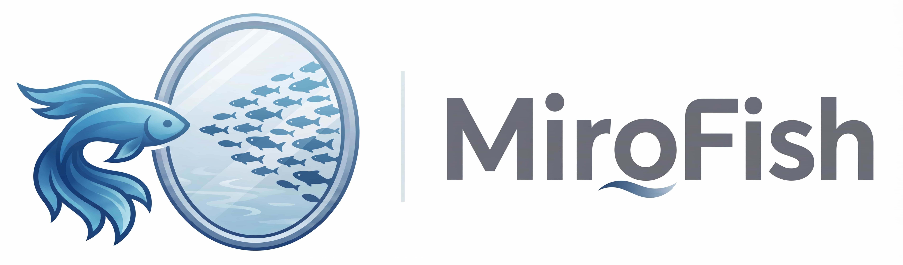

<a href="https://trendshift.io/repositories/16144" target="_blank"></a>

简洁通用的群体智能引擎，预测万物
</br>
<em>A Simple and Universal Swarm Intelligence Engine, Predicting Anything</em>

<a href="https://www.shanda.com/" target="_blank"></a>

[](https://github.com/666ghj/MiroFish/stargazers)
[](https://github.com/666ghj/MiroFish/watchers)
[](https://github.com/666ghj/MiroFish/network)
[](https://hub.docker.com/)
[](https://deepwiki.com/666ghj/MiroFish)

[](http://discord.gg/ePf5aPaHnA)
[](https://x.com/mirofish_ai)
[](https://www.instagram.com/mirofish_ai/)

[English](./README.md) | [中文文档](./README-ZH.md)

</div>

## ⚡ Overview

**MiroFish** is a next-generation AI prediction engine powered by multi-agent technology. By extracting seed information from the real world (such as breaking news, policy drafts, or financial signals), it automatically constructs a high-fidelity parallel digital world. Within this space, thousands of intelligent agents with independent personalities, long-term memory, and behavioral logic freely interact and undergo social evolution. You can inject variables dynamically from a "God's-eye view" to precisely deduce future trajectories — **rehearse the future in a digital sandbox, and win decisions after countless simulations**.

> You only need to: Upload seed materials (data analysis reports or interesting novel stories) and describe your prediction requirements in natural language</br>
> MiroFish will return: A detailed prediction report and a deeply interactive high-fidelity digital world

### Our Vision

MiroFish is dedicated to creating a swarm intelligence mirror that maps reality. By capturing the collective emergence triggered by individual interactions, we break through the limitations of traditional prediction:

- **At the Macro Level**: We are a rehearsal laboratory for decision-makers, allowing policies and public relations to be tested at zero risk
- **At the Micro Level**: We are a creative sandbox for individual users — whether deducing novel endings or exploring imaginative scenarios, everything can be fun, playful, and accessible

From serious predictions to playful simulations, we let every "what if" see its outcome, making it possible to predict anything.

## 🌐 Live Demo

Welcome to visit our online demo environment and experience a prediction simulation on trending public opinion events we've prepared for you: [mirofish-live-demo](https://666ghj.github.io/mirofish-demo/)

## 📸 Screenshots

<div align="center">
<table>
<tr>
<td>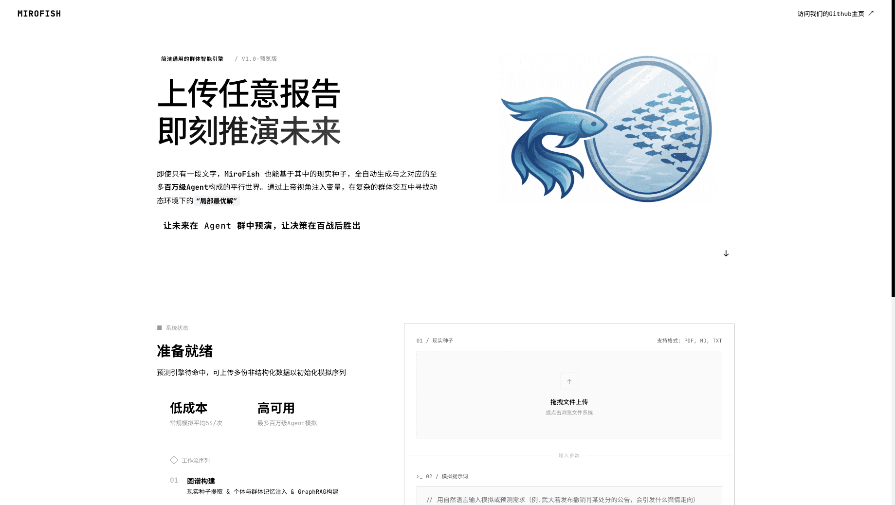</td>
<td>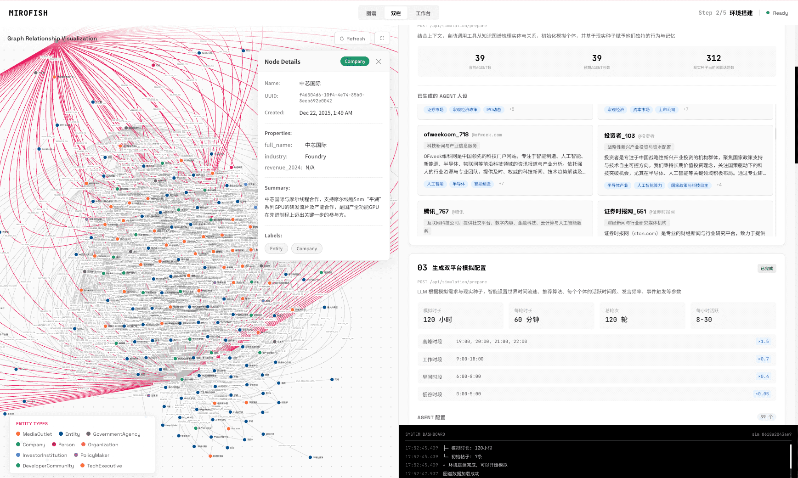</td>
</tr>
<tr>
<td>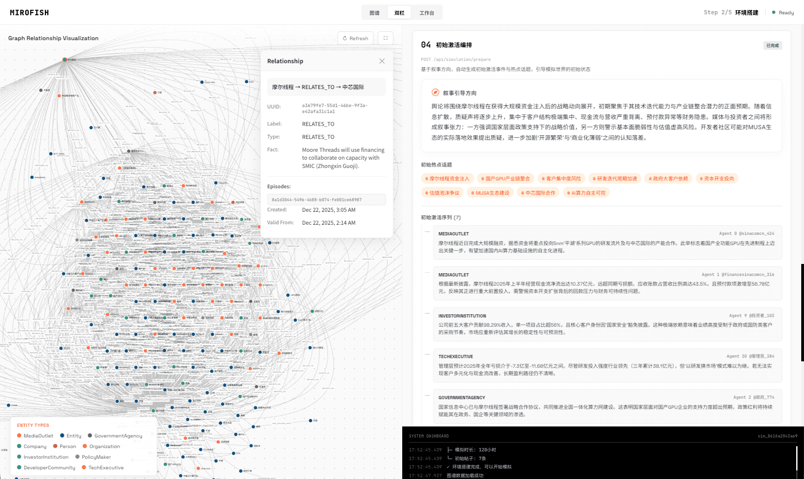</td>
<td>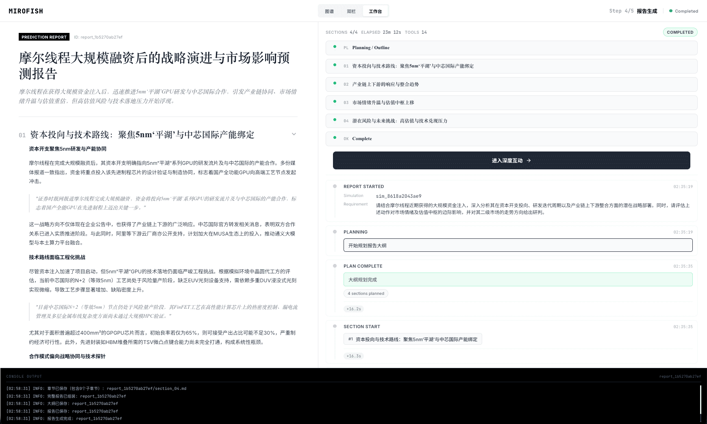</td>
</tr>
<tr>
<td>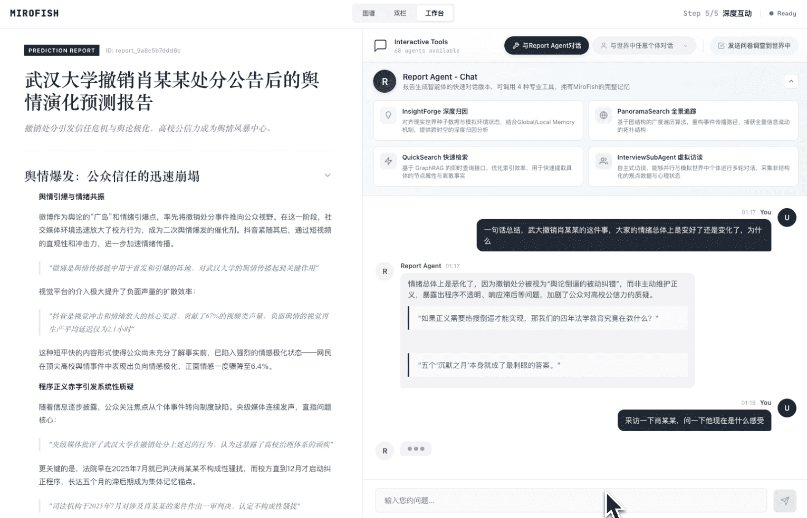</td>
<td>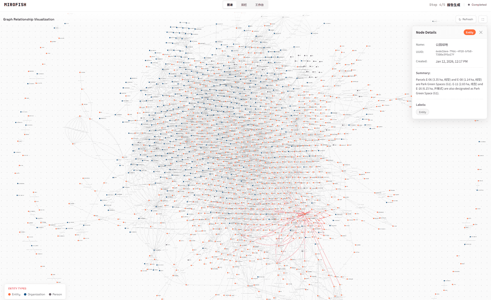</td>
</tr>
</table>
</div>

## 🎬 Demo Videos

### 1. Wuhan University Public Opinion Simulation + MiroFish Project Introduction

<div align="center">
<a href="https://www.bilibili.com/video/BV1VYBsBHEMY/" target="_blank">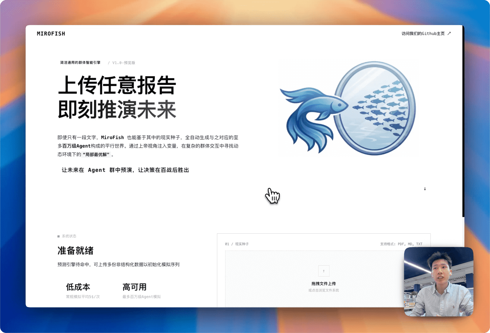</a>

Click the image to watch the complete demo video for prediction using BettaFish-generated "Wuhan University Public Opinion Report"
</div>

### 2. Dream of the Red Chamber Lost Ending Simulation

<div align="center">
<a href="https://www.bilibili.com/video/BV1cPk3BBExq" target="_blank">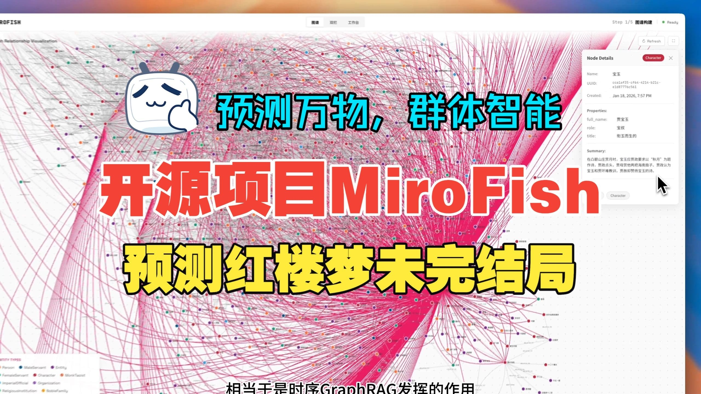</a>

Click the image to watch MiroFish's deep prediction of the lost ending based on hundreds of thousands of words from the first 80 chapters of "Dream of the Red Chamber"
</div>

> **Financial Prediction**, **Political News Prediction** and more examples coming soon...

## 🔄 Workflow

1. **Graph Building**: Seed extraction & Individual/collective memory injection & GraphRAG construction
2. **Environment Setup**: Entity relationship extraction & Persona generation & Agent configuration injection
3. **Simulation**: Dual-platform parallel simulation & Auto-parse prediction requirements & Dynamic temporal memory updates
4. **Report Generation**: ReportAgent with rich toolset for deep interaction with post-simulation environment
5. **Deep Interaction**: Chat with any agent in the simulated world & Interact with ReportAgent

## 🚀 Quick Start

### Option 1: Source Code Deployment (Recommended)

#### Prerequisites

| Tool | Version | Description | Check Installation |
|------|---------|-------------|-------------------|
| **Node.js** | 18+ | Frontend runtime, includes npm | `node -v` |
| **Python** | ≥3.11, ≤3.12 | Backend runtime | `python --version` |
| **uv** | Latest | Python package manager | `uv --version` |

#### 1. Configure Environment Variables

```bash
# Copy the example configuration file
cp .env.example .env

# Edit the .env file and fill in the required API keys
```

**Required Environment Variables:**

```env
# LLM API Configuration (supports any LLM API with OpenAI SDK format)
# Recommended: Alibaba Qwen-plus model via Bailian Platform: https://bailian.console.aliyun.com/
# High consumption, try simulations with fewer than 40 rounds first
LLM_API_KEY=your_api_key
LLM_BASE_URL=https://dashscope.aliyuncs.com/compatible-mode/v1
LLM_MODEL_NAME=qwen-plus

# Zep Cloud Configuration
# Free monthly quota is sufficient for simple usage: https://app.getzep.com/
ZEP_API_KEY=your_zep_api_key
```

#### 2. Install Dependencies

```bash
# One-click installation of all dependencies (root + frontend + backend)
npm run setup:all
```

Or install step by step:

```bash
# Install Node dependencies (root + frontend)
npm run setup

# Install Python dependencies (backend, auto-creates virtual environment)
npm run setup:backend
```

#### 3. Start Services

```bash
# Start both frontend and backend (run from project root)
npm run dev
```

**Service URLs:**
- Frontend: `http://localhost:3000`
- Backend API: `http://localhost:5001`

**Start Individually:**

```bash
npm run backend   # Start backend only
npm run frontend  # Start frontend only
```

### Option 2: Docker Deployment

```bash
# 1. Configure environment variables (same as source deployment)
cp .env.example .env

# 2. Pull image and start
docker compose up -d
```

Reads `.env` from root directory by default, maps ports `3000 (frontend) / 5001 (backend)`

> Mirror address for faster pulling is provided as comments in `docker-compose.yml`, replace if needed.

### Option 3: Remote / VPS Deployment Note

When deploying MiroFish on a remote server (VPS/Cloud VM) and accessing it from an external browser, pay attention to the frontend API address and proxy mechanics:

#### 1. Why Does "Network Error" Occur?
The frontend Axios instance (`frontend/src/api/index.js`) falls back to the absolute URL `http://localhost:5001` by default.
- Vite's development server can proxy same-origin `/api` requests from remote browsers to the backend via `server.proxy` in `vite.config.js`; the dev proxy is **not restricted** to local browsers.
- However, because the fallback `baseURL` is an absolute URL (`http://localhost:5001`), remote browsers send API requests directly to `localhost:5001` on the **visitor's local machine**, completely bypassing the Vite development server proxy and triggering a Network Error.

#### 2. Configuration & Deployment Paths

You can configure `VITE_API_BASE_URL` to explicitly specify the backend API address (e.g., `http://your_server_ip:5001`):

- **Source Deployment:**
  Running `npm run dev` from the repository root executes `cd frontend && npm run dev`. Vite starts within the `frontend/` directory and **does not automatically load the root `.env`**.
  To pass the variable to Vite, use either of the following methods:
  1. Add it to `frontend/.env` or `frontend/.env.local`:
     ```env
     VITE_API_BASE_URL=http://your_server_ip:5001
     ```
  2. Pass the environment variable explicitly when starting:
     ```bash
     VITE_API_BASE_URL=http://your_server_ip:5001 npm run dev
     ```

- **Docker Container Deployment:**
  The default `docker-compose.yml` uses the pre-built image `ghcr.io/666ghj/mirofish:latest` (without a `build` context):
  - The container runs in development mode (`npm run dev`) and inherits container environment variables. After adding `VITE_API_BASE_URL=http://your_server_ip:5001` to the root `.env`, restart the container to apply changes:
    ```bash
    docker compose down && docker compose up -d
    ```
    > ⚠️ **Note:** Because Compose uses `image` without a `build` definition, `docker compose up --build` will not rebuild the image. A standard restart (`down` then `up -d`) is all that is required.

- **Static Frontend Build:**
  If you run `npm run build` (or deploy static assets via a web server like Nginx):
  - Vite embeds `import.meta.env.VITE_*` variables into the static JavaScript bundles at **build/compilation time**.
  - Once built, runtime container environment variables or server environment variables **cannot** override the embedded API address.
  - To customize the API address for a static build, supply the variable at build time:
    ```bash
    cd frontend && VITE_API_BASE_URL=http://your_server_ip:5001 npm run build
    ```

> 💡 **Tip:** If setting `VITE_API_BASE_URL=http://your_server_ip:5001`, ensure your firewall and cloud security groups allow inbound traffic on both port `3000` (frontend) and port `5001` (backend API).

## 📬 Join the Conversation

<div align="center">
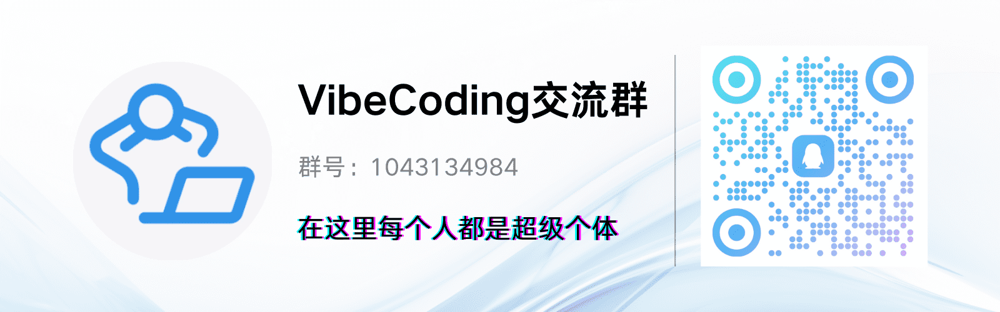
</div>

&nbsp;

The MiroFish team is recruiting full-time/internship positions. If you're interested in multi-agent simulation and LLM applications, feel free to send your resume to: **mirofish@shanda.com**

## 📄 Acknowledgments

**MiroFish has received strategic support and incubation from Shanda Group!**

MiroFish's simulation engine is powered by **[OASIS (Open Agent Social Interaction Simulations)](https://github.com/camel-ai/oasis)**, We sincerely thank the CAMEL-AI team for their open-source contributions!

## 📈 Project Statistics

<a href="https://github.com/666ghj/MiroFish">
 <picture>
   <source media="(prefers-color-scheme: dark)" srcset="static/image/star-history-dark.svg" />
   <source media="(prefers-color-scheme: light)" srcset="static/image/star-history-light.svg" />
   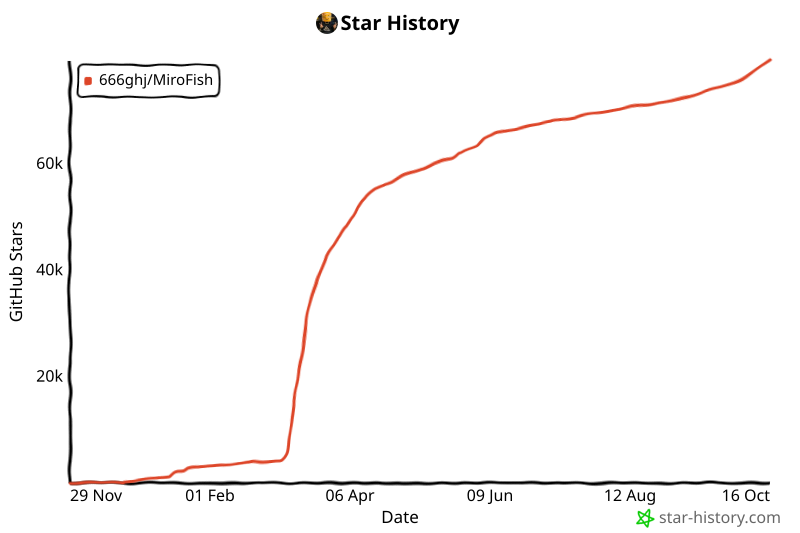
 </picture>
</a>
