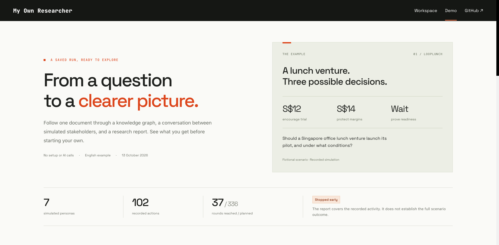

<p align="center">
  
</p>

<h1 align="center">My Own Researcher</h1>

<p align="center">
  <strong>Bring a document. Ask a question. Explore what could happen.</strong><br>
  Your personal research workbench for knowledge graphs, simulated perspectives, and reports.
</p>

<p align="center">
  <a href="#see-it-in-action">See the demo</a> ·
  <a href="#install-and-run">Get started</a> ·
  <a href="#choose-your-inference-provider">Choose your AI</a> ·
  <a href="#use-it-from-another-ai-agent">Connect an agent</a> ·
  <a href="README-ZH.md">中文</a>
</p>

<p align="center">
  <strong>15 agent CLI options</strong> &nbsp; / &nbsp;
  <strong>Local graph storage</strong> &nbsp; / &nbsp;
  <strong>Browser + MCP</strong>
</p>

---

A proposal lands on your desk. The facts are scattered, the stakeholders want different things, and the next step is unclear. **My Own Researcher turns that material into a scenario you can explore:** connect the facts, give simulated stakeholders a voice, and inspect a report of what happened.

**📄 Sources → 🕸️ Knowledge graph → 👥 Simulated discussion → 📝 Report → 💬 Follow-up**

Upload a PDF, Markdown, or text file, then bring a question: *What assumptions are we missing? Where might people disagree? What would need to be true for this to work?*

An independent fork of **[MiroFish](https://github.com/666ghj/MiroFish)**, licensed under [AGPL-3.0](LICENSE).

> [!NOTE]
> Simulation helps you explore assumptions and possible scenarios. Its output is model-generated material to investigate, not a guarantee of real-world outcomes.

## See it in action

**Meet LoopLunch: one lunch venture, two price points, and a reason to wait.**

Should a fictional Singapore office lunch venture charge **S$12**, charge **S$14**, or postpone its pilot? Follow the source brief through a knowledge graph, seven simulated personas, their discussion, and the saved report.

[](#try-the-demo)

*Fictional scenario, recorded run: 7 personas · 102 actions · 37 of 336 planned rounds. The report explains that partial coverage.*

### Try the demo

The demo uses bundled example data. **No backend, Docker, or AI account needed.** With Node.js 22.12+ installed:

```sh
git clone https://github.com/Handriantog/My-Own-Researcher.git
cd My-Own-Researcher
npm ci --prefix frontend
npm run frontend
```

Open **[localhost:4317/demo](http://localhost:4317/demo)**, or choose **Demo** on the homepage. Exploring the demo makes no backend or AI requests.

Prefer to read the artifacts? Open the [source brief](frontend/public/demo/looplunch-brief.pdf) and [saved report](frontend/src/demo/looplunch-report.md).

## What this fork adds

| | What you get |
| --- | --- |
| 🔑 **Bring your AI account** | Use your ChatGPT-authenticated Codex CLI, or choose from 14 additional agent CLIs. Default local mode needs no LLM API key and never automatically falls back to a paid API. |
| 🕸️ **Keep the graph local** | Graphiti + Neo4j store your graph on your machine. No Zep account or key required in local mode. |
| 🎛️ **Choose the pace** | Quick, Moderate, and Full round budgets; confirmed early stopping; clearly labeled partial reports. |
| 🔄 **Recover unfinished work** | Checkpoints for graph ingestion, agent preparation, memory saving, and report sections, plus visible retries and manual recovery. |
| 📄 **Take the report with you** | Markdown and PDF downloads. PDF export renders the saved report locally without another AI call. |
| 🤝 **Work through your agent** | MCP tools expose the same projects, graphs, simulations, and reports over Streamable HTTP or stdio. |
| 🌐 **Start in English** | English is the default interface language; the inherited language selector remains available. |

> [!IMPORTANT]
> **Local storage does not mean offline AI.** Document text and simulation conversations go to your selected CLI's model service (OpenAI in the default Codex setup). Its authentication, billing, and account/model limits apply; inference is not free or unlimited.

<details>
<summary><strong>What changed from the inherited MiroFish setup?</strong></summary>

### Compared with the inherited MiroFish setup

This comparison describes the upstream baseline inherited by this fork, not every current upstream release.

| Area | Inherited MiroFish baseline | This fork's local setup |
| --- | --- | --- |
| Research workflow | Source documents, graph, OASIS simulation, report, interaction | Retains that workflow |
| Language inference | OpenAI-compatible API configuration | Codex or another supported agent CLI; optional API mode retained |
| Graph service | Zep Cloud credentials | Local Graphiti + Neo4j; no Zep account required |
| Interface | Upstream multilingual interface | English default and fork identity |
| Interrupted work | Existing task and run handling | Additional checkpoints, visible retries, and manual recovery |
| Run controls | Planned simulation rounds | Quick/Moderate/Full budgets and warned early stop with partial reports |
| Report export | Markdown report download | Adds locally rendered PDF download |

</details>

## Install and run

### 1. Gather the essentials

| Requirement | What you need |
| --- | --- |
| Operating system | macOS, Linux, or WSL |
| Runtimes | Node.js **22.12+** and Python **3.11–3.12** |
| Python packages | [uv](https://docs.astral.sh/uv/) |
| Graph database | Docker with Compose, with Docker running |
| AI inference | An installed agent CLI and an account you can sign in to |

The quickstart uses the [Codex CLI](https://learn.chatgpt.com/docs/cli) with your ChatGPT login. Using another CLI? Follow [Choose your inference provider](#choose-your-inference-provider) for its configuration and login steps.

### 2. Set up the workbench

If you already cloned the repository for the demo, start at `npm ci` from that checkout.

```sh
git clone https://github.com/Handriantog/My-Own-Researcher.git
cd My-Own-Researcher
npm ci
npm ci --prefix frontend
uv sync --project backend --frozen
uv sync --project graph_platform --frozen
python3 scripts/configure_local_graph.py
codex login
```

Choose **Sign in with ChatGPT** during login. The configuration helper creates private credentials in the ignored `.env`, preserves existing secrets and provider selections, and selects local Graphiti storage. Each CLI manages its own login; keep those credentials out of `.env`.

### 3. Start exploring

```sh
npm run graph:up
npm run dev
```

Open **[localhost:4317/?lang=en](http://localhost:4317/?lang=en)** and wait for graph readiness before uploading. The first graph-service start downloads the local embedding and reranking models.

**Next time:** run those same two commands. **To stop:** press Ctrl+C, then run `npm run graph:down` to stop Neo4j while keeping its data. If you started the demo-only frontend, stop it before starting the full app.

<details>
<summary><strong>What runs where? Configuration and ports</strong></summary>

Docker runs **Neo4j only**, using `compose.local-graph.yml`. The frontend, backend, graph service, MCP adapter, and selected agent CLI run natively on the host.

| Service | Default address |
| --- | --- |
| Browser interface | `http://localhost:4317` |
| MCP endpoint | `http://127.0.0.1:4318/mcp` |
| Backend | `http://127.0.0.1:5001` |
| Graph service | `http://127.0.0.1:5002` |

The commented [`.env.example`](.env.example) explains provider settings, local credentials, and timeouts. Override `FRONTEND_PORT`, `MCP_PORT`, or `FLASK_PORT` in the root `.env` as needed. The web server reports an occupied port instead of silently choosing another.

The helper defaults to `LLM_PROVIDER=codex`, preserves an existing selection, accepts `--provider`, and sets `GRAPH_PROVIDER=graphiti`.

</details>

## Start a research run

1. **Bring the context.** Upload a short PDF, Markdown, or text file and describe the question you want to explore.
2. **Connect the dots.** Build the graph, then prepare the simulation's agents and configuration.
3. **Set the pace.** Review the round count and choose an effort level before starting:

   | Quick | Moderate | Full (default) |
   | --- | --- | --- |
   | 25% of planned rounds | 50% of planned rounds | 100% of planned rounds |

4. **Watch the discussion.** Let the simulation finish, or choose **Stop simulation** and confirm. Keep the services running while saved activity is added to graph memory.
5. **Read, question, export.** Generate the report, inspect its evidence and coverage notes, and use **Download PDF**. Continue with agent or report interaction when available.

> [!TIP]
> Start with a small source and a few agents. CLI requests are serialized, so larger graphs, more agents, and more rounds take more time and allowance. Effort percentages scale round counts, not total runtime or token consumption.

<details>
<summary><strong>If a run stops or fails</strong></summary>

- **Retries stay visible.** Supported workflow failures receive up to three automatic retries after the initial failure, delayed by 2, 5, and 10 seconds while the browser page is open. Manual recovery remains available.
- **Checkpoints preserve completed work.** Recovery covers unfinished graph ingestion, agent preparation, memory saving, and report sections. A restarted simulation process begins at round 1; it does not resume an interrupted OASIS process mid-round.
- **Stopping takes time to finalize.** Saved actions can support a labeled partial report after graph memory finishes saving. Graph finalization and report generation still make AI calls and consume allowance.

See [setup, storage, and recovery](docs/my-own-researcher.md) for diagnostics and recovery boundaries.

</details>

## Choose your inference provider

**Codex is the default.** Claude Code, Gemini CLI, Cursor, and 11 other agent CLIs are also available as native presets. Install and sign in to your chosen CLI under the same OS user who runs the app.

For example, after installing and signing in to Claude Code:

```sh
python3 scripts/configure_local_graph.py --provider claude-code
uv run --project backend python backend/scripts/check_agent.py --provider claude-code
```

The check verifies configuration and executable availability **without running inference**. Restart the app after changing providers.

<details>
<summary><strong>All 15 providers: IDs, executables, and MCP settings</strong></summary>

Use the provider ID for both `LLM_PROVIDER` and the MCP configuration generator.

| Agent | Provider ID | Inference executable | MCP configuration destination |
| --- | --- | --- | --- |
| Codex | `codex` | `codex` | `~/.codex/config.toml` |
| Claude Code | `claude-code` | `claude` | `.mcp.json` |
| Antigravity | `antigravity` | `agy` (CLI required) | `.agents/mcp_config.json` |
| Cursor | `cursor` | `agent` | `.cursor/mcp.json` |
| Devin CLI | `devin` | `devin` | `.devin/mcp_config.json` |
| Factory Droid | `factory-droid` | `droid` | `.factory/mcp.json` |
| Gemini CLI | `gemini` | `gemini` | `.gemini/settings.json` |
| GitHub Copilot CLI | `copilot` | `copilot` | `~/.copilot/mcp-config.json` |
| Grok Build CLI | `grok` | `grok` | `~/.grok/config.toml` |
| Kimi Code | `kimi` | `kimi` (current Node.js CLI) | `.kimi-code/mcp.json` |
| OpenCode | `opencode` | `opencode` (v2) | `opencode.json` |
| Pi | `pi` | `pi` (current native MCP release) | `.pi/mcp.json` |
| Qwen Code | `qwen` | `qwen` | `.qwen/settings.json` |
| Hermes Agent | `hermes` | `hermes` | `~/.hermes/config.yaml` |
| Muse | `muse` | `muse` (Meta Muse Code) | `~/.config/muse/settings.json` |

</details>

<details>
<summary><strong>Optional settings and live compatibility checks</strong></summary>

For non-Codex agents, optional settings in the root `.env` include:

```dotenv
LLM_PROVIDER=claude-code
GRAPH_PROVIDER=graphiti
# AGENT_BIN=/absolute/path/to/claude
# AGENT_MODEL=an-exact-model-id-available-to-your-account
AGENT_TIMEOUT_SECONDS=600
AGENT_QUEUE_TIMEOUT_SECONDS=600
```

Document analysis, personas, configuration, simulations, reports, interviews, and **local Graphiti extraction** follow your provider selection. Another CLI provider does not require a Codex login.

`GRAPH_LLM_PROVIDER` can select a different graph CLI. When `LLM_PROVIDER=openai`, graph extraction keeps its existing Codex default unless overridden. `AGENT_MODEL` applies to non-Codex requests; Codex retains its `CODEX_*` settings. API and boost keys never select an automatic fallback.

To verify login, text/JSON output, simulation actions, and graph compatibility, opt into a small live check. **These commands use your account allowance.** Replace `claude-code` with your provider ID.

```sh
uv run --project backend python backend/scripts/check_agent.py --provider claude-code --live
# Optional: exercise two agents in a temporary OASIS simulation
uv run --project backend python backend/scripts/check_agent.py --provider claude-code --live --oasis
```

</details>

The additional native presets are **experimental and version-sensitive**. Command construction, parsers, and routing are tested with fake executables; live account compatibility needs checking on your installation. CLI tool restrictions are not an OS sandbox: clients may retain native tools, user configuration, hooks, or MCP discovery.

See the [provider setup guide](docs/agent-providers.md) for installation, version requirements, tool-control limitations, and `AGENT_COMMAND_JSON` wrappers.

## Use it from another AI agent

Your assistant can operate the workbench through **MCP**, without opening the browser. Inference and MCP are independent: Cursor can drive the research while Claude Code performs the underlying inference.

After completing installation, start the services:

```sh
npm run graph:up
npm run dev:agent
```

If `npm run dev` is already running, MCP is already available. Use only one backend. `npm run mcp` starts just the adapter when the backend and graph services are running separately.

**Connect with Streamable HTTP:** `http://127.0.0.1:4318/mcp` · **Tool timeout:** at least **900 seconds**.

Generate settings for your client using a provider ID from the table above:

```sh
python3 scripts/agent_mcp.py --provider claude-code
python3 scripts/agent_mcp.py --provider gemini
python3 scripts/agent_mcp.py --provider cursor --transport stdio
python3 scripts/agent_mcp.py --list
```

The generator **prints configuration only**. Merge its `my-own-researcher` entry into your client's settings, preserve existing servers, then restart or reload the agent. Ask it to call `get_status` to check the connection without inference.

### Give your agent a first mission

> Use the my-own-researcher MCP tools to research the supplied sources. Check readiness, create a project with a unique upload_id, build its graph, and prepare a Reddit-only simulation. Run a two-round pilot, wait for simulation and memory saving to finish, then generate and retrieve the report. Preserve evidence and coverage limitations. Read research://workflow for the call sequence and recovery rules.

The server exposes typed tools and a `research://workflow` resource. Agents can submit text/Markdown with `create_project`, build and search graphs, run simulations, poll progress, and retrieve report Markdown with `get_report`. Browser-uploaded projects, including PDFs, are available too. Inference tools use your selected provider and account allowance.

<details>
<summary><strong>Generic stdio configuration and custom connections</strong></summary>

For clients that accept generic stdio settings, replace both `/absolute/path/My-Own-Researcher` paths with your checkout:

```json
{
  "mcpServers": {
    "my-own-researcher": {
      "command": "uv",
      "args": [
        "run", "--project", "/absolute/path/My-Own-Researcher/backend", "--frozen",
        "python", "/absolute/path/My-Own-Researcher/backend/mcp_server.py"
      ]
    }
  }
}
```

Stdio launches an adapter; the backend and graph services must still be running. Use an absolute path to `uv` if it is missing from your agent's `PATH`. Set the client's tool timeout separately; its configuration field varies by client.

The generator's stdio output automatically uses absolute checkout paths and resolves `uv` when available. Use `--url http://127.0.0.1:YOUR_PORT/mcp` for a custom HTTP port. Use stdio for Hermes when calls can exceed its HTTP idle limit.

See [per-agent MCP setup](docs/agent-mcp.md) for configuration locations, schemas, timeout units, and compatibility notes, or the [MCP guide](docs/mcp.md) for tools, polling, retries, and remote access through SSH.

</details>

## Storage and operating limits

| Keep in mind | What it means |
| --- | --- |
| **One person, one backend** | This is a single-user local app. Keep services on loopback; multiple backend workers and shared public hosting are unsupported. |
| **Back up both halves** | Projects and checkpoints live in `backend/uploads/`; Neo4j data lives in its Docker volume. Back them up together. |
| **Local data, remote inference** | Local files and graphs stay on your machine. Inference content goes to the selected CLI's model provider. |
| **Existing graphs keep their provider** | Changing configuration does not migrate project data. The graph layer covers this app's needs, not the full Zep product. |

## Find your next step

| I want to… | Go here |
| --- | --- |
| Configure storage or recover a run | [Workbench guide](docs/my-own-researcher.md) |
| Tune the default Codex setup | [Codex provider guide](docs/codex-provider.md) |
| Use a different CLI for inference | [Agent provider guide](docs/agent-providers.md) |
| Connect my assistant | [Per-agent MCP setup](docs/agent-mcp.md) |
| Understand the research tools and workflow | [MCP guide](docs/mcp.md) |
| Read the Chinese overview | [中文说明](README-ZH.md) |

## Attribution and license

Built on **[MiroFish](https://github.com/666ghj/MiroFish)** by the MiroFish team, whose contributors created the original interface and research simulation workflow. This independent fork retains the **[GNU Affero General Public License v3.0](LICENSE)**. See the [upstream documentation](https://github.com/666ghj/MiroFish#readme) for the original project.

Powered by **[OASIS](https://github.com/camel-ai/oasis)** from CAMEL-AI for simulation, and **[Graphiti](https://github.com/getzep/graphiti)** + **[Neo4j](https://github.com/neo4j/neo4j)** for local graph processing. Dependencies and models retain their respective licenses. Independent maintenance does not imply endorsement by these projects or OpenAI.

---

<p align="center"><strong>Your next research run starts with a good question.</strong><br><a href="#install-and-run">Set up your workbench →</a></p>
